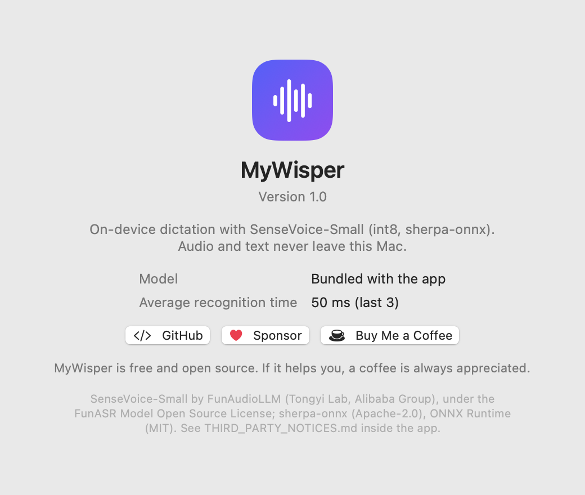
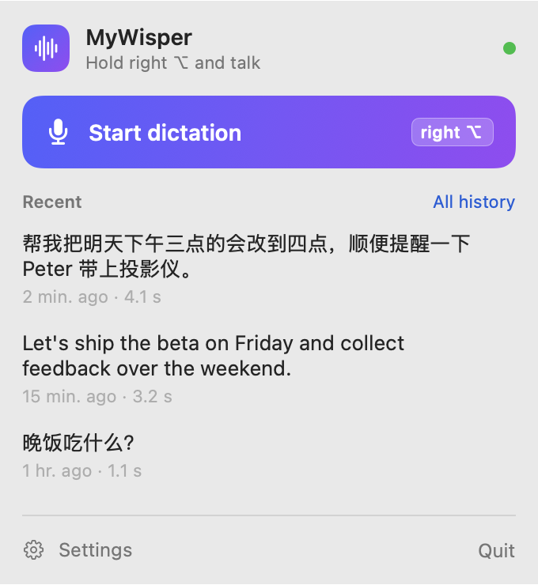
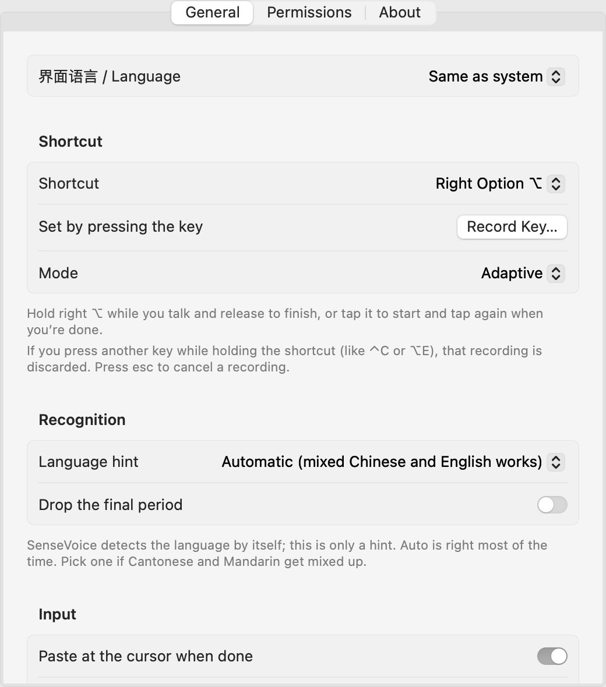

<p align="center">
  
</p>

<h1 align="center">MyWisper</h1>

<p align="center">
  <b>Hold a key, speak, and the text appears at your cursor. 100% on your Mac.</b><br>
  English · <a href="README.zh-CN.md">简体中文</a>
</p>

<p align="center">
  <a href="https://github.com/phg1024/MyWisper/releases/latest"></a>
  
  
  <a href="LICENSE"></a>
  <a href="https://github.com/sponsors/phg1024"></a>
  <a href="https://buymeacoffee.com/phg1024"></a>
</p>

MyWisper is a menu bar dictation app for macOS. Hold a shortcut (right Option by default), talk, let go — the text is typed into whatever app you're in. Speech recognition runs entirely on your Mac with [SenseVoice-Small](https://github.com/FunAudioLLM/SenseVoice) through [sherpa-onnx](https://github.com/k2-fsa/sherpa-onnx): no account, no cloud, no network access at all.

- **Chinese, English, Cantonese, Japanese, Korean**, and Chinese–English mixed in one sentence, detected automatically.
- **Fast**: a few seconds of speech is transcribed in about 50 ms on Apple silicon.
- **Private**: the app contains no networking code; audio stays in memory and is discarded after recognition.
- **Native**: SwiftUI, a small floating HUD with a live waveform, history, English and Chinese interface.

<p align="center">
  
  &nbsp;
  
</p>
<p align="center">
  
</p>

## Install

1. Download `MyWisper-x.y.z.dmg` from [Releases](https://github.com/phg1024/MyWisper/releases/latest), open it and drag **MyWisper** into **Applications**.
2. **First launch.** MyWisper isn't signed with an Apple Developer ID yet, so macOS stops it the first time ("Apple could not verify…"). Click **Done**, then open **System Settings › Privacy & Security**, scroll down to *Security* and click **Open Anyway** next to MyWisper. You only do this once.
   <br>Or, in Terminal: `xattr -dr com.apple.quarantine /Applications/MyWisper.app`
3. The welcome window asks for two permissions:
   - **Microphone**: to hear you.
   - **Accessibility**: for the global shortcut and to paste the text at your cursor (it sends ⌘V).
4. Optional: Settings › General › **Open at login**.

Requires macOS 15 or later on Apple silicon (M1 or newer).

## Use

- **Adaptive mode** (default): hold the key while you talk and release to finish, or tap it once to start and tap again when done.
- Other keys: left Option, right Command, left or right Control, or Fn. Easiest: Settings › General › **Record Key…** and press the key you want. (For Fn, set System Settings › Keyboard › "Press 🌐 key to" to "Do Nothing".)
- The microphone opens about 0.12 s after the key goes down, so shortcuts like ⌃C or ⌥E never trigger it; pressing another key while holding the shortcut discards that recording. **esc** cancels.
- Without Accessibility permission, the text is copied to the clipboard instead.
- Recent results are in the menu bar window (click to copy); the full, searchable history is under **All history**.
- Interface language: Settings › General › **界面语言 / Language** (System, 简体中文, English).

## Privacy

- Nothing goes online. The only network code is the optional, off-by-default **Correction** (Settings › General), which talks to a language model server on this Mac and refuses any address other than 127.0.0.1 / localhost. With it off, MyWisper opens no connections at all: check with `lsof -i -a -p $(pgrep -x MyWisper)`.
- Recognition works identically with networking blocked by a sandbox; the model ships inside the app.
- Dictated text is written to the clipboard as *this Mac only*, so Universal Clipboard doesn't send it to your other devices. The previous clipboard is restored after pasting (can be turned off).
- Stored on disk: the history at `~/Library/Application Support/MyWisper/history.json` (readable only by you; can be turned off or cleared) and your preferences. Audio is never written to disk, unless you turn on Settings › General › **Save recordings** (used to compare recognizers with `tools/compare_asr.py`; kept in `Recordings/` next to the history).
- The GitHub / Sponsor / Buy Me a Coffee buttons in About open your browser only when clicked.

## Build from source

Needs Xcode (or the Command Line Tools) on an Apple silicon Mac.

```bash
git clone https://github.com/phg1024/MyWisper.git && cd MyWisper
./fetch-deps.sh        # sherpa-onnx 2.0.1 libraries into Vendor/, SenseVoice model into models/ (~1 GB)
./build.sh install     # builds build/MyWisper.app and copies it to ~/Applications
```

The first build creates a self-signed code signing certificate in `.signing/` (not in git). macOS ties the Microphone and Accessibility permissions to that certificate, so later builds keep them. Don't delete it.

Other tools: `MyWisper --transcribe a.wav [--language zh]` transcribes files; `MyWisper --snapshot <dir> [en|zh]` renders the UI to PNGs. `./release.sh 1.0.0` makes a release DMG (notarized when a Developer ID certificate is available).

## Support

MyWisper is free. If it saves you some typing, you can [sponsor on GitHub](https://github.com/sponsors/phg1024) or [buy me a coffee](https://buymeacoffee.com/phg1024). Bug reports and ideas are welcome in [Issues](https://github.com/phg1024/MyWisper/issues).

## Credits and license

MyWisper is released under the [MIT License](LICENSE).

- Speech model: **SenseVoice-Small** by FunAudioLLM (Tongyi Lab, Alibaba Group), under the [FunASR Model Open Source License 1.1](https://github.com/modelscope/FunASR/blob/main/MODEL_LICENSE); ONNX conversion by the sherpa-onnx project.
- [sherpa-onnx](https://github.com/k2-fsa/sherpa-onnx) (Apache-2.0) and [ONNX Runtime](https://github.com/microsoft/onnxruntime) (MIT).

Full texts are in [ThirdParty/](ThirdParty/) and inside the app.
