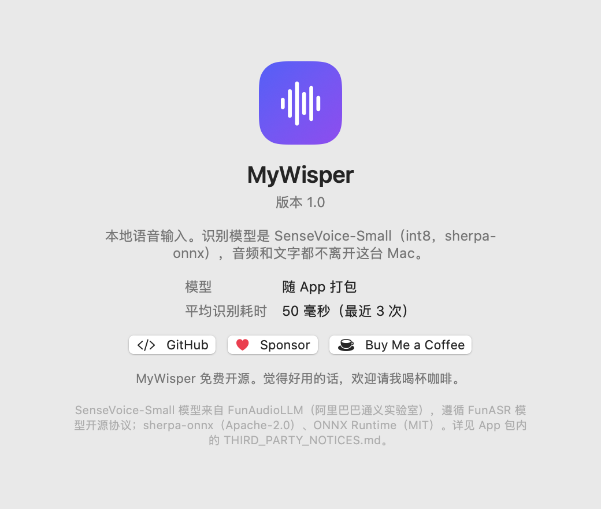
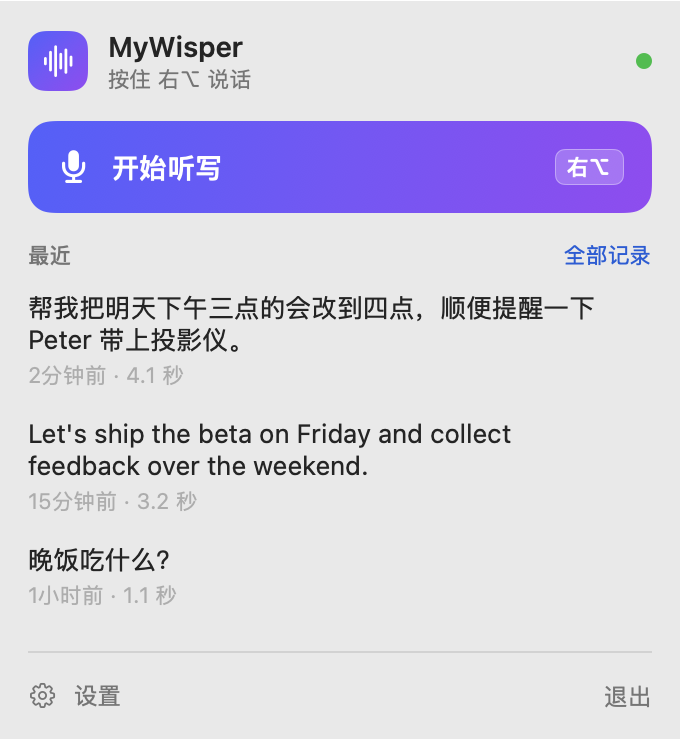
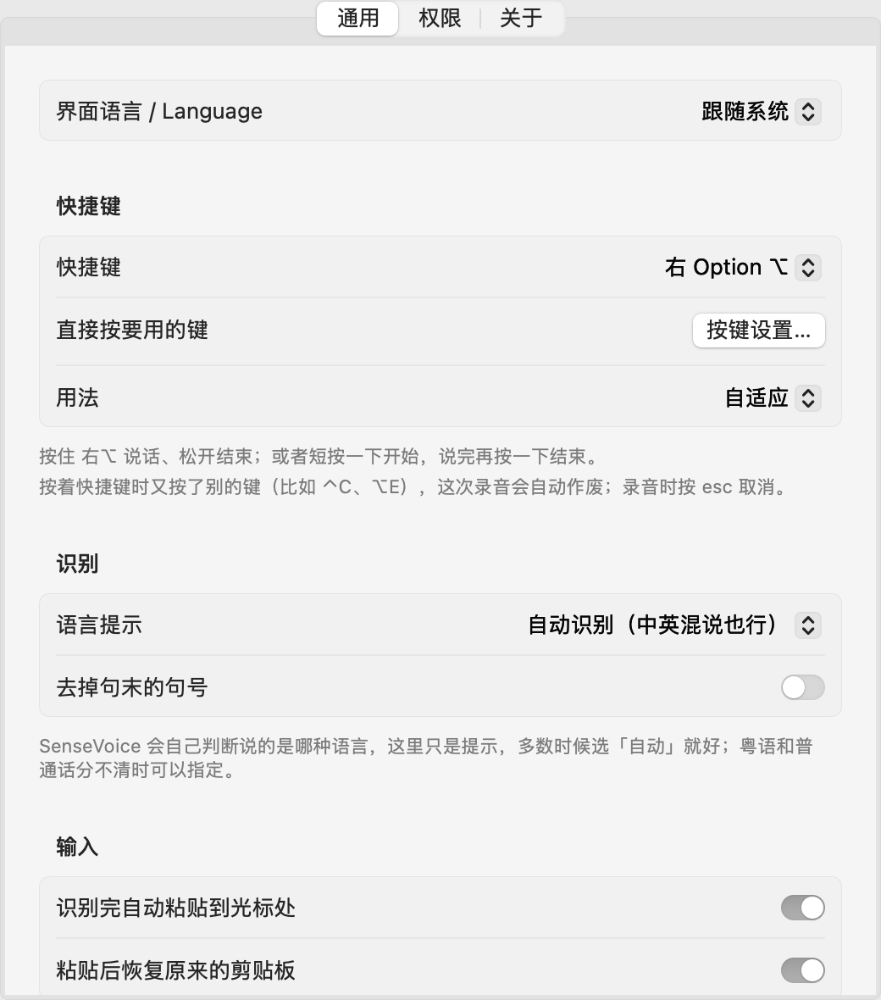

<p align="center">
  
</p>

<h1 align="center">MyWisper</h1>

<p align="center">
  <b>按住一个键说话，松开后文字出现在光标处。全部在你的 Mac 上完成。</b><br>
  <a href="README.md">English</a> · 简体中文
</p>

<p align="center">
  <a href="https://github.com/phg1024/MyWisper/releases/latest"></a>
  
  
  <a href="LICENSE"></a>
  <a href="https://github.com/sponsors/phg1024"></a>
  <a href="https://buymeacoffee.com/phg1024"></a>
</p>

MyWisper 是 macOS 菜单栏上的语音输入工具。按住快捷键（默认右 Option）说话，松开，文字就输入到你正在用的 App 里。语音识别用 [SenseVoice-Small](https://github.com/FunAudioLLM/SenseVoice)，经 [sherpa-onnx](https://github.com/k2-fsa/sherpa-onnx) 在本机运行：不用注册账号，不走云端，完全不联网。

- **中文、英文、粤语、日语、韩语**，一句话里中英混说也行，自动识别语言。
- **快**：几秒钟的话，在 Apple 芯片上约 50 毫秒出字。
- **私密**：App 里没有任何联网代码；录音只在内存里，识别完就丢掉。
- **原生**：SwiftUI 写的，录音时屏幕底部有带实时波形的提示条，有历史记录，界面支持中文和英文。

<p align="center">
  
  &nbsp;
  
</p>
<p align="center">
  
</p>

## 安装

1. 从 [Releases](https://github.com/phg1024/MyWisper/releases/latest) 下载 `MyWisper-x.y.z.dmg`，打开后把 **MyWisper** 拖进「应用程序」。
2. **第一次打开**：MyWisper 还没有用 Apple 开发者证书签名，所以第一次打开时 macOS 会拦下来（提示「Apple 无法验证…」）。点「完成」，然后打开 **系统设置 › 隐私与安全性**，往下拉到「安全性」，点 MyWisper 旁边的 **仍要打开**。只需要做一次。
   <br>或者在终端里运行：`xattr -dr com.apple.quarantine /Applications/MyWisper.app`
3. 欢迎窗口会请你授权两项：
   - **麦克风**：听你说话。
   - **辅助功能**：全局快捷键，以及把文字粘贴到光标处（模拟按 ⌘V）。
4. 可选：设置 › 通用 › **登录时自动启动**。

需要 macOS 15 或更新版本，Apple 芯片（M1 或更新）。

## 用法

- **自适应**（默认）：按住快捷键说话、松开结束；或者短按一下开始，说完再按一下结束。
- 也可以换成左 Option、右 Command、左 / 右 Control 或 Fn。最省事的是 设置 › 通用 › **按键设置…**，然后直接按你想用的键。（用 Fn 的话，要在 系统设置 › 键盘 里把「按下 🌐 键时」设成「无操作」。）
- 按下快捷键约 0.12 秒后才开麦，所以 ⌃C、⌥E 这类组合键不会触发录音；按着快捷键时又按了别的键，这次录音会作废。录音时按 **esc** 取消。
- 没有辅助功能权限时，识别结果只复制到剪贴板。
- 菜单栏弹窗里有最近的几条结果（点一下复制）；完整的历史在 **全部记录** 里，可以搜索。
- 界面语言：设置 › 通用 › **界面语言 / Language**（跟随系统、简体中文、English）。

## 隐私

- 不联网。唯一的网络代码是默认关闭的 **纠错**（设置 › 通用），它只连这台 Mac 上运行的大模型服务，127.0.0.1 / localhost 以外的地址一律拒绝。不开纠错时 MyWisper 不建立任何连接，可以用 `lsof -i -a -p $(pgrep -x MyWisper)` 自己查。
- 用沙箱禁掉网络后识别结果完全一样，模型就在 App 里。
- 识别出的文字写进剪贴板时标成「仅本机」，不会经「通用剪贴板」同步到你的其他设备。粘贴后会恢复原来的剪贴板（可以关掉）。
- 存在磁盘上的只有：历史记录 `~/Library/Application Support/MyWisper/history.json`（只有你能读，可以关掉或清空）和偏好设置。录音不会写到磁盘，除非你打开了 设置 › 通用 › **保存录音**（用 `tools/compare_asr.py` 对比识别引擎时用，存在历史记录旁边的 `Recordings/` 里）。
- 「关于」页里的 GitHub、Sponsor、Buy Me a Coffee 按钮，只有你点了才会用浏览器打开。

## 从源码构建

需要 Apple 芯片的 Mac，装好 Xcode（或 Command Line Tools）。

```bash
git clone https://github.com/phg1024/MyWisper.git && cd MyWisper
./fetch-deps.sh        # 下载 sherpa-onnx 2.0.1 的库到 Vendor/，SenseVoice 模型到 models/（约 1GB）
./build.sh install     # 生成 build/MyWisper.app 并复制到 ~/Applications
```

第一次构建会在 `.signing/` 生成一张自签名的代码签名证书（不进 git）。macOS 把麦克风和辅助功能权限跟这张证书绑定，所以以后重新构建权限都还在。别删它。

其他：`MyWisper --transcribe a.wav [--language zh]` 识别音频文件；`MyWisper --snapshot <目录> [en|zh]` 把界面渲染成 PNG。`./release.sh 1.0.0` 生成发布用的 DMG（钥匙串里有 Developer ID 证书时会自动公证）。

## 支持

MyWisper 是免费的。如果它帮你省了打字的时间，欢迎 [在 GitHub 上赞助](https://github.com/sponsors/phg1024) 或者 [请我喝杯咖啡](https://buymeacoffee.com/phg1024)。问题和建议请提到 [Issues](https://github.com/phg1024/MyWisper/issues)。

## 致谢和许可证

MyWisper 以 [MIT 许可证](LICENSE) 发布。

- 语音模型：**SenseVoice-Small**，来自 FunAudioLLM（阿里巴巴通义实验室），遵循 [FunASR 模型开源协议 1.1](https://github.com/modelscope/FunASR/blob/main/MODEL_LICENSE)；ONNX 版本由 sherpa-onnx 项目转换。
- [sherpa-onnx](https://github.com/k2-fsa/sherpa-onnx)（Apache-2.0）和 [ONNX Runtime](https://github.com/microsoft/onnxruntime)（MIT）。

完整许可证文本在 [ThirdParty/](ThirdParty/) 目录和 App 包里。
